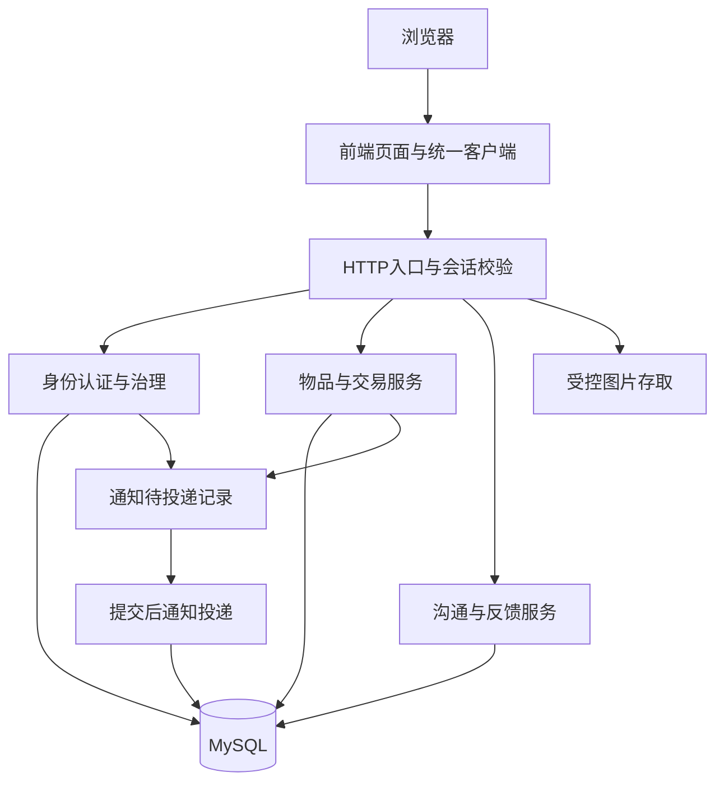

# 校园二手交易与物品流转平台架构设计讨论稿

修订日期：2026-11-24。版本0.2，供全组评审。适用本轮V1、V2实现与V3系统测试。以原需求FR01—FR24、BR01—BR20为输入；本文提出可实施设计，技术选择交由Q/ADR评审后进入架构基线。

## 1 设计目标与系统边界

系统处理单件实物的信息、交易意图和线下交付记录，核心是唯一占用、本人事实确认、历史依据和治理可追溯。付款、实物验收及交接由当事人完成；不增设在线支付、物流、自动收货、凭据找回或多库存。

两版实现：V1打通注册认证、发布审核、浏览咨询、订单交付确认；V2完成治理、争议、反馈、统计及异常加固。V3系统验证。原需求P2仍是本期范围，不因阶段后置删除。

## 2 总体结构

采用前后端分离开发、模块化单体后端的候选方案：Vue3/JavaScript/Vite负责界面，Java17/Spring Boot/MyBatis负责API和业务，MySQL负责事务数据。版本号和运行拓扑在V1准入前确认，不照抄旧机器配置。开发期可由Vite代理/api，交付时可将静态页面放入应用包；不要求先上云。

前端不读数据库，不以按钮隐藏代替授权；后端模块共享会话与数据契约，不各写一套订单状态。通知是站内告知，不参与决定交易能否成立。

## 3 模块职责与代码组织

| 模块 | 主维护 | 职责与调用边界 |
|---|---|---|
| frontend/core、交易页面 | A | 布局、路由、请求、身份变更、物品订单页；C复用公共组件写管理页面；A实现社区用户页面 |
| backend/identity、governance、messaging | C | 注册会话、CSRF、资格审核、治理争议与聊天授权；管理页面；不代买方确认交付 |
| backend/trade、persistence | B | 物品版本、订单快照、占用、取消交付、数据库迁移；对外提供交易状态查询及治理动作入口 |
| backend/community、notification | B | 收藏、双方评价及信誉、统计、站内通知；聊天实现归C |
| 独立验证与验收 | D | 测试设施、接口/数据库/浏览器独立检查、缺陷复验、每版验收；不写产品功能 |
| 共享契约 | 全组共同完成，提供/调用双方确认 | DTO、错误、鉴权上下文、迁移、状态变更事件，避免多方修改同一大文件 |

目录细分名属于实现建议，V1准备任务确认后落实。依赖方向为控制器→业务服务→数据访问；跨模块用明确业务方法，避免治理代码直接写订单阶段、聊天代码复制可交易判断。C提供会话授权能力，每个服务仍核对象和状态。

## 4 数据与事务

建议持久对象：accounts、verifications及材料版本、items/item_versions、orders及快照、reservations、deliveries、operation_receipts、favorites、reviews、messages、reports、disputes及追加证据、audit_records、notification_outbox、assets。B维护共享迁移，C提出治理/聊天数据需求，全组确认，D检查可验证性。表名不作为已冻结接口。

数据库约束候选：账户标识唯一；认证通过身份与账号绑定唯一；物品版本(item_id,version)唯一；占用item_id唯一；回执按操作者和请求意图唯一；收藏(user_id,item_id)唯一；评价(order_id,author_id)唯一。约束是服务检查的最后防线，不替代权限判断。

订单成立事务共同写订单快照、占用、回执和必要审计；确认完成共同写订单完成、物品成交及解除占用，重复确认不重复计数。普通取消先查角色、阶段、交付声明、登记与争议，再原子终止和释放占用；物品是否可售重新核全部独立条件。交付、取消、争议治理不能分别更新一半对象。

建议统一锁顺序：账户ID排序→物品→订单→争议/治理对象；锁前读取只用于定位，获得锁后重读状态。重试先验身份归属，再返回同意图已有结果；同键异内容拒绝。不得用当前受限或占用状态否定合法旧回执。

## 5 关键设计

物品关键内容修改形成新版本并重审；旧审核不适用新版本，有效订单时不得改标的。订单保存成立时的描述与约定金额，商品或昵称后续变化不改历史快照。

隐藏、账户受限、占用与争议是独立条件。治理恢复只解除对应条件，不直接上架；异常终止后物品仍不可售，核查归属后显式重发。争议补证追加并保留作者时间，结案后不能把新证据悄悄并入旧裁决依据。

公开读采用字段白名单，过滤联系方式等私有信息；完整内容仅本人或必要治理可见。认证与图片按用途、归属和可见性授权。退出或换号清理表单、资源引用和在途请求，防止前后身份串用。密码不静默trim，具体长度、上传限制等技术参数需确认。

站内通知候选用Outbox：业务事务写待投递记录，提交后独立投递，失败保留可重试状态且不回滚已成立业务。Outbox入库失败属于本次业务事务失败，与已提交后的投递失败区分。故障证据分别验证，不无条件吞数据库异常。

## 6 接口与运行

/api作为候选前缀；Session/CSRF延续旧接口方向，HTTP状态及分页等参数见接口文档和Q。真实MySQL为目标数据环境；启动时迁移结构，演示种子仅作用于明确的合成数据环境，不覆盖旧数据。开发机、端口、图片路径、MySQL位置均外部配置，密钥不进入浏览器、文档和日志。Q-RB-01确认联调环境，服务器另行安排。

## 7 风险与验证

重点检查多买方竞争、取消对交付、治理对新交易、争议补证对结案、通知故障、账号切换及公开投影。以原需求确定预期，通过MySQL多连接、服务故障注入和真实浏览器分别验证。测试准备见testing/测试用例.md；旧项目通过记录不能计入本轮执行。

## 8 关键调用与并行边界

A按OpenAPI的同schema模拟数据先做页面；B按合成订单构建交易；C按合成身份及订单查询接口构建审核和聊天；D先核对预期并写独立案例。共享身份上下文、订单状态查询、治理变更入口、通知事件在V1首先确认，小批量真实联调。

查询订单不授予修改权。C治理请求调用B交易动作，由一个应用事务覆盖订单/物品/占用及处置事实；不能C先写争议、B后写订单的两个独立HTTP请求拼事务。C发通知事件，B通知服务持久化并投递；D用测试注入控制故障，不把测试开关带入产品接口。

模块具体函数/DTO见接口与关键设计；数据库职责见数据与状态设计。A维护共享前端入口，B维护迁移序列，C维护会话授权，其他成员改这些文件先协调。D的测试代码和验收预期由相应实际成员复核。

## 9 技术选择与成本

本轮建议保留熟悉的Vue/Java/MySQL，模块化单体即可；不引入微服务、支付、短信、多库存、推荐系统或新消息队列。真实通知投递先用应用内批量补投或轮询机制；启用频率、上限和退避需配置并记录。锁定依赖以实际构建环境核验版本，不在文档里编造已安装环境。

所有技术方案见ADR，属于供确认的具体设计，不以AI起草代替全组评审。当前可以审阅文档和准备任务；实际成员完成V1准入后才编码，完整阶段结束仍须四人一致通过。
