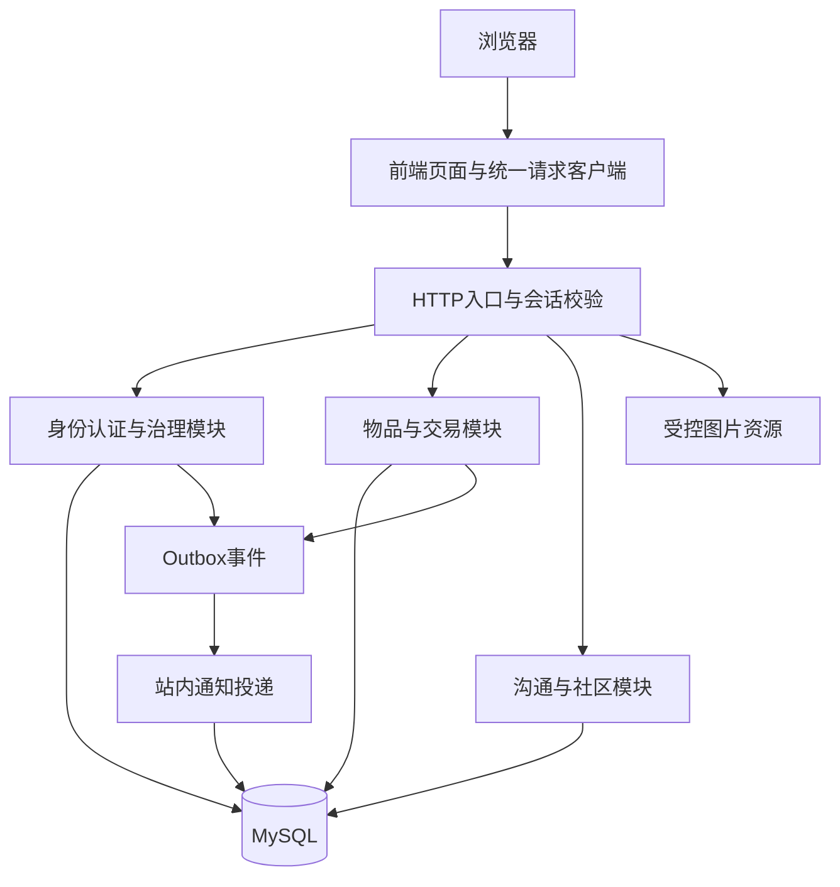

# 校园二手交易与物品流转平台架构设计讨论稿

修订日期：2026-11-12，版本1.0。本文件汇总全组在架构讨论阶段形成的系统边界、技术结构、模块职责和关键实现方案，并作为架构基线与ADR的输入。

## 1 设计目标与系统边界

系统面向校园内单件闲置物品的信息发布、交易协商、线下交付和治理追踪。设计重点包括单件物品唯一占用、买卖双方事实确认、订单历史留存、权限控制和治理过程可追溯。

系统支持注册登录、校园身份认证、物品发布与审核、浏览搜索、咨询沟通、订单处理、交付确认、收藏评价、举报争议、站内通知和管理统计。付款、实物验收及线下交接由交易双方完成。

项目按三个版本实施：V1完成核心交易闭环；V2完善社区、治理、通知、统计及系统集成；V3开展系统测试、质量完善和交付整理。

## 2 总体结构

系统采用前后端分离开发、模块化单体部署。Vue 3、JavaScript和Vite负责浏览器端界面；Java 17、Spring Boot和MyBatis负责API及业务服务；MySQL负责事务数据。开发环境通过Vite代理`/api`，交付环境通过统一入口提供页面和接口。

前端通过API访问业务能力，后端统一执行授权和状态校验。各模块共享会话、错误响应和订单状态定义。通知用于传递业务变化，不参与交易事务结果判断。

## 3 模块职责与代码组织

| 模块 | 主责 | 职责与调用边界 |
|---|---|---|
| frontend/core及用户页面 | A | 页面布局、请求封装、登录状态、物品与订单交互、社区用户页面 |
| backend/trade及persistence | B | 物品版本、订单快照、有效占用、交付取消、数据库迁移和交易状态查询 |
| backend/community及notification | B | 收藏、双方评价、信誉、统计、Outbox及站内通知 |
| backend/identity及governance | C | 注册会话、CSRF、身份认证、物品审核、账号限制、举报和争议处理 |
| backend/messaging及管理页面 | C | 商品咨询、订单聊天、只读控制、管理操作入口 |
| 独立验证与验收 | D | 测试设施、接口与数据库检查、浏览器回归、阶段验收 |
| 共享契约 | 全组 | DTO、错误结构、鉴权上下文、迁移顺序、状态变化和接口说明 |

后端依赖方向为控制器、业务服务、数据访问。跨模块协作通过明确的业务方法完成，治理模块调用交易服务执行状态变化，沟通模块复用统一的交易资格判断。

## 4 数据与事务

主要持久化对象包括账户、认证申请、物品及版本、订单及快照、有效占用、交付登记、操作回执、收藏、评价、消息、举报、争议、审计记录、通知Outbox和图片资源。

数据库约束包括账户名唯一、校园身份唯一绑定、物品版本唯一、单件物品有效占用唯一、操作意图唯一、收藏关系唯一和订单评价作者唯一。服务层负责业务判断，数据库约束负责并发情况下的一致性保护。

订单成立事务同时保存订单快照、有效占用、操作回执、审计事实和通知事件。订单完成事务同时更新订单、物品、占用和完成时间。取消、交付及争议处理均在锁定相关对象后重新读取状态，并在同一事务内完成关联数据变化。

统一锁顺序为账户、物品、订单、争议或治理对象。重要写操作先校验身份归属，再根据意图键返回已有结果或执行新操作。

## 5 关键设计

物品标题、分类、描述、价格和图片等关键内容修改时形成新版本并重新审核。订单保存成立时的物品描述和约定金额，保证历史记录不随物品后续编辑而变化。

隐藏、账号限制、交易占用和争议状态相互独立。治理操作只改变对应条件，系统根据全部条件重新计算物品是否可展示、可咨询或可交易。争议证据采用追加方式记录作者和时间，结案依据保持可追溯。

公开查询使用字段白名单；完整联系方式、认证材料和治理信息通过本人或管理员授权接口访问。退出登录或切换账号时清理表单、资源引用和在途请求，保持前后身份一致。

业务事务登记Outbox事件，提交后由通知服务独立投递。事件具有稳定标识，支持批量补投和重试，业务结果与通知投递状态分别保存。

## 6 接口与运行

所有业务接口统一使用`/api`前缀。登录会话采用Session，写操作携带CSRF令牌；错误响应使用统一的`{message}`结构。接口字段、状态码和数据模型以[接口与关键设计](接口与关键设计.md)及[OpenAPI](openapi.yaml)为准。

MySQL作为正式数据环境，应用启动时按顺序执行结构迁移。开发和测试种子仅用于独立合成环境。端口、数据库连接、图片路径和通知参数通过环境变量配置，口令及令牌不进入浏览器包、工程文档和运行日志。

## 7 质量验证

质量验证覆盖以下内容：

- 多买方竞争和单件物品唯一占用；
- 交付、取消、确认和争议处理的状态一致性；
- 通知投递与业务事务的相互独立；
- 登录切换、越权访问和公开字段投影；
- 数据库升级、重启恢复和图片资源持久化；
- 浏览器端核心业务闭环及异常提示。

验证分别使用模块测试、MySQL多连接测试、接口测试、故障注入和真实浏览器操作完成，结果纳入阶段测试与验收记录。

## 8 并行协作边界

A依据OpenAPI和模拟数据实现页面；B依据订单和物品模型实现交易及社区能力；C依据身份上下文和交易查询接口实现认证、治理、聊天及管理能力；D依据需求、ADR和接口契约设计独立测试。

身份上下文、订单状态查询、治理动作入口和通知事件优先形成共享契约。A维护前端公共入口，B维护数据库迁移序列，C维护会话与授权能力，D维护独立测试设施。共享文件的修改由相关提供方和调用方共同核对。

## 9 技术选择与成本

项目采用Vue、Java、Spring Boot、MyBatis和MySQL组成的成熟技术栈，以模块化单体满足课程项目的部署和协作需要。通知使用数据库Outbox与应用内补投机制。系统范围聚焦校园二手交易，不扩展在线支付、物流、多库存、微服务和独立消息队列。
